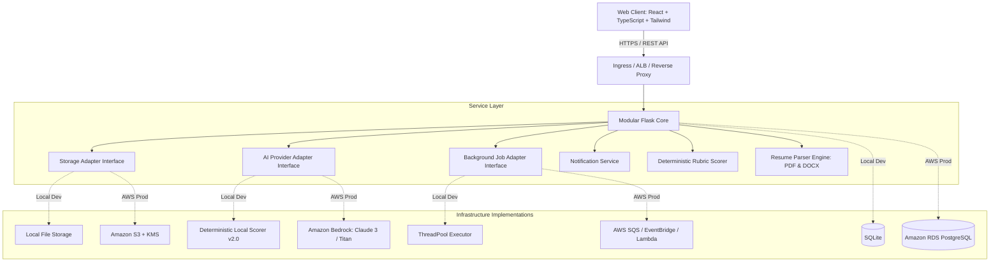

# Resume Battle 2.0 — Architecture Specification

## 1. Executive System Overview

**Resume Battle 2.0: Career Intelligence Arena** is engineered as a high-performance modular monolith designed for immediate local reliability and streamlined AWS cloud migration. The platform decouples core domain logic from infrastructure dependencies via explicit adapter interfaces.



---

## 2. Component Architecture

### Frontend (Client Tier)
- **Framework**: React 19 with TypeScript, bundled by Vite.
- **Styling**: Tailwind CSS with custom dark SaaS tokens, glassmorphism, and responsive breakpoints.
- **Visualizations**: Recharts (`RadarChart`, `BarChart`, `AreaChart`) for multi-dimensional rubric metrics.
- **State & Communication**: Context API (`AuthContext`, `ToastContext`), centralized `ApiClient` with auto JWT header injection, 401 handling, and cross-tab session syncing.

### Backend (Application Tier)
- **Runtime**: Python 3.11+ / Flask 3.1 with blueprint-based domain decomposition:
  - `auth`: Registration, JWT generation, password hashing, and instant demo login.
  - `resumes`: Untrusted file parsing (PDF/DOCX/TXT), document sanitization, storage dispatch, and version snapshots.
  - `analyses`: Deterministic 9-dimension rubric evaluation, requirement-evidence matching, and automatic mission triggering.
  - `battles`: Head-to-head resume comparison, dimension delta computations, and winner arbitration.
  - `career`: Career DNA competence graph, category clustering, and project verification anchors.
  - `missions`: Career Quest missions, difficulty progression, points ledger, and evidence submission.
  - `interviews`: Application Simulator mock interviews, deterministic question sequencing, candidate scoring, and checklists.
  - `projects`: Project Proof portfolio profiles, completeness scoring, and truthful bullet suggestions.
  - `community`: Battle League challenges, anonymous handles, and private rankings.
  - `analytics`: Telemetry calculations, score trends, and gap frequency analysis.
  - `documents`: File retention, renaming, deletion, and download through storage abstractions.
  - `settings`: Candidate profile, security, privacy modes, GDPR JSON export, and account deletion.

---

## 3. Core Service Abstractions

### A. Storage Service (`app.services.storage`)
```python
class StorageService(ABC):
    def save_document(file_bytes, filename, content_type) -> str: ...
    def get_document(storage_key) -> bytes: ...
    def delete_document(storage_key) -> bool: ...
    def create_download_url(storage_key, expires_in) -> str: ...
    def document_exists(storage_key) -> bool: ...
```
- **Local Provider**: Stores files in `LOCAL_STORAGE_DIR`, generates unique random keys, prevents directory traversal attacks, and serves downloads through authenticated routes.
- **AWS S3 Provider**: Uses Boto3 client with server-side encryption (`AES256` or AWS KMS) and generates short-lived presigned URLs.

### B. AI Provider (`app.services.ai`)
```python
class AIProvider(ABC):
    def evaluate_resume(resume_text, job_text, custom_skills) -> dict: ...
    def generate_interview_questions(role_title, job_text, resume_text) -> list: ...
    def evaluate_interview_answer(question_text, expected_points, user_answer) -> dict: ...
    def suggest_resume_bullets(project) -> list: ...
```
- **Local Provider**: Uses deterministic rubric scoring engine (9 dimensions, action verb detection, metrics calculation, and exact quote excerpting). 100% offline and cost-free.
- **AWS Bedrock Provider**: Prepared Boto3 adapter connecting to foundation models (Anthropic Claude 3 Sonnet or Amazon Titan), automatically falling back to the local provider if credentials are not configured.

### C. Background Jobs (`app.services.jobs`)
```python
class BackgroundJobService(ABC):
    def submit_job(task_name, payload, handler) -> str: ...
    def get_job_status(job_id) -> dict: ...
```
- **Local Worker**: Uses Python `ThreadPoolExecutor` with in-memory status dictionary.
- **AWS Adapter**: Prepared for SQS queue submission and Lambda / ECS worker execution.
