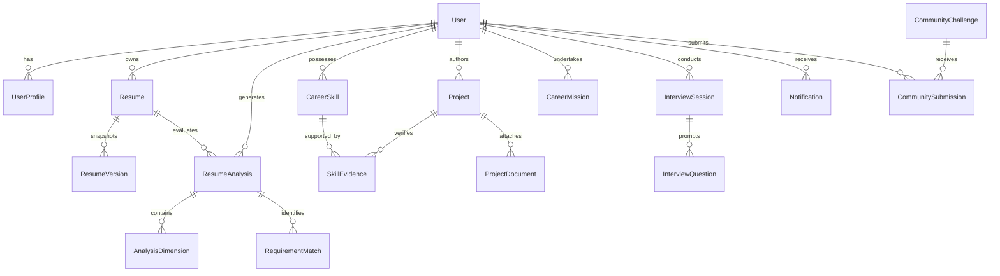

# Resume Battle 2.0 — Database Schema & Data Ownership

## 1. Relational Entity Relationship Diagram



---

## 2. Entity Descriptions & Constraints

| Table Name | Primary Key | Foreign Keys | Key Columns | Ownership & Privacy Rules |
| :--- | :--- | :--- | :--- | :--- |
| `users` | `id (UUID)` | None | `email`, `username`, `password_hash`, `target_role` | Root account identity. Passwords hashed using PBKDF2-SHA256. |
| `user_profiles` | `id (UUID)` | `user_id -> users.id` | `bio`, `github_url`, `linkedin_url`, `privacy_mode` | 1-to-1 extension with privacy mode controls. |
| `resumes` | `id (UUID)` | `user_id -> users.id` | `storage_key`, `original_filename`, `extracted_text` | Private document record. Must match `current_user.id`. |
| `resume_versions` | `id (UUID)` | `resume_id`, `user_id` | `version_name`, `content_snapshot`, `is_preferred` | Historical immutable snapshot for comparisons. |
| `job_descriptions` | `id (UUID)` | `user_id (nullable)` | `title`, `company`, `raw_text`, `is_sample` | Sample jobs are public; custom user jobs are private. |
| `resume_analyses` | `id (UUID)` | `user_id`, `resume_id` | `overall_score`, `rubric_version`, `verdict` | Evaluation assessment result record. |
| `analysis_dimensions` | `id (UUID)` | `analysis_id` | `dimension_key`, `score`, `weight`, `explanation` | 9 rubric dimensions for explainability. |
| `requirement_matches`| `id (UUID)` | `analysis_id` | `requirement_text`, `match_status`, `evidence_text`| Granular requirement coverage with resume excerpts. |
| `resume_battles` | `id (UUID)` | `user_id`, `resume_a_id`, `resume_b_id` | `winner_resume_id`, `comparison_summary` | Head-to-head comparison results. |
| `career_skills` | `id (UUID)` | `user_id -> users.id` | `name`, `category`, `proficiency_level`, `verified` | Persistent Career DNA skill catalog. |
| `skill_evidence` | `id (UUID)` | `skill_id`, `project_id`| `evidence_type`, `title`, `verification_status` | Verifiable anchors supporting skills. |
| `projects` | `id (UUID)` | `user_id -> users.id` | `title`, `description`, `technologies_json` | Portfolio proof items with bullet generator. |
| `career_missions` | `id (UUID)` | `user_id -> users.id` | `skill_gap`, `difficulty`, `points`, `status` | Learning missions with points ledger. |
| `interview_sessions`| `id (UUID)` | `user_id -> users.id` | `session_type`, `status`, `overall_score` | Application Simulator sessions. |
| `interview_questions`| `id (UUID)`| `session_id` | `question_text`, `user_answer`, `score`, `feedback` | Questions and evaluated candidate responses. |
| `community_challenges`| `id (UUID)`| None | `title`, `role_category`, `description` | Public opt-in community arenas. |
| `community_submissions`| `id (UUID)`| `challenge_id`, `user_id`| `anonymous_handle`, `rubric_score`, `badge` | Anonymous entries with zero contact leakage. |
| `notifications` | `id (UUID)` | `user_id -> users.id` | `title`, `message`, `notification_type`, `is_read` | In-app notification alerts. |
| `audit_events` | `id (UUID)` | `user_id (nullable)` | `action`, `resource_type`, `resource_id`, `ip_address` | Security audit trail for compliance. |

---

## 3. Data Isolation and IDOR Prevention

Every API query accessing private records enforces explicit tenant filtering:
```python
# Guaranteed User Isolation Pattern:
resume = Resume.query.filter_by(id=resume_id, user_id=current_user.id).first()
if not resume:
    return jsonify({'error': 'Resume not found or access denied.'}), 404
```
This guarantees that guessing a UUID cannot disclose another user's resume, evaluation, or project.
